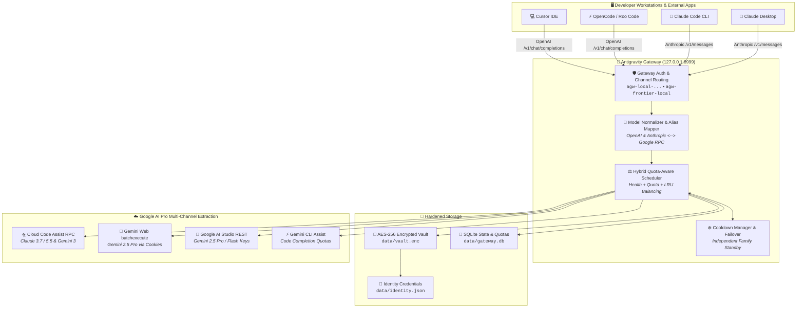

# 🚀 Secured Google AI Extractor & Multi-Account API Gateway

[](https://python.org)
[](https://fastapi.tiangolo.com)
[](https://platform.openai.com/docs/api-reference)
[](https://docs.anthropic.com/en/api/getting-started)
[](#-zero-leakage-vault-security)
[](LICENSE)

A high-performance, self-hosted local inference gateway that extracts and aggregates **Google AI Pro / Gemini Advanced subscriptions** across multiple accounts into unified, standard **OpenAI (`/v1/chat/completions`)** and **Anthropic (`/v1/messages`)** endpoints.

Extract every drop of intelligence and quota from your Google AI Pro accounts—unlocking **Claude 3.7 / 5.5 Sonnet, Claude Opus, 1M Mega-Context, and Gemini 2.5 / 3 Pro** with zero per-token API charges, automated multi-account load balancing, and intelligent 429 failover.

---

## 📑 Table of Contents

1. [Key Features](#-key-features)
2. [System Architecture](#-system-architecture)
3. [Curated Model Catalog](#-curated-model-catalog)
4. [Installation & Quick Start](#-installation--quick-start)
5. [Account Connections Setup Guide](#-account-connections-setup-guide)
   - [Step 1: Google OAuth Sign-In (Cloud Code Engine)](#step-1-google-oauth-sign-in-cloud-code-engine)
   - [Step 2: Gemini Web Session Cookies (`__Secure-1PSID`)](#step-2-gemini-web-session-cookies-__secure-1psid)
   - [Step 3: Google AI Studio API Key (`AIza...`)](#step-3-google-ai-studio-api-key-aiza)
   - [Step 4: Gemini Cloud CLI (Optional)](#step-4-gemini-cloud-cli-optional)
6. [Client Integration Guides](#-client-integration-guides)
   - [Cursor IDE](#1-cursor-ide-setup)
   - [Claude Code CLI](#2-claude-code-cli-setup)
   - [OpenCode & Roo Code](#3-opencode--roo-code-setup)
   - [Claude Desktop GUI](#4-claude-desktop-gui-setup)
7. [Developer & Debugging Guide](#-developer--debugging-guide)
   - [Project Structure](#project-structure)
   - [Load Balancer & Scheduler Algorithm](#load-balancer--scheduler-algorithm)
   - [Running Verification Tests](#running-verification-tests)
   - [Debugging Upstream Protocols](#debugging-upstream-protocols)
8. [License](#-license)

---

## 🌟 Key Features

* **4-Way Extraction Engine**: Extract quotas simultaneously across all 4 pathways per Google account:
  1. 🛸 **Google Cloud Code OAuth** (`agy`): Native Google Cloud Code token unlocking Claude 3.7 / 5.5 Sonnet and Gemini 3 Pro.
  2. 🍪 **Gemini Advanced Web Session** (`gweb`): Consumer `gemini.google.com` sessions via cookie extraction (`__Secure-1PSID`).
  3. 🔑 **Google AI Studio Key** (`studio`): Independent developer RPM quotas with zero billing requirements.
  4. ⚡ **Gemini Cloud CLI** (`gcli`): Automated developer CLI channel.
* **Hybrid Intelligent Load Balancer**: Combines health scoring, token capacity, remaining quota percentage, and LRU (Least Recently Used) idle weighting to distribute requests smoothly across multiple Google accounts.
* **Seamless Rate-Limit (429) Failover**: Isolated cooldown managers prevent account lockouts and rotate upstream accounts instantly without dropping user requests.
* **Zero-Leakage AES-256 Vault**: All OAuth tokens, refresh keys, and browser session cookies are encrypted on disk using AES-256-GCM.
* **Dual OpenAI & Anthropic Protocol Support**: Fully compatible with tools expecting OpenAI (`/v1/chat/completions`) or Anthropic (`/v1/messages`).
* **Modern Web Dashboard**: Real-time quota meters, 4-way connection health monitoring, 1-click Chrome cookie detection, and interactive setup wizards.

---

## 🏗️ System Architecture



---

## 🤖 Curated Model Catalog

The gateway exposes all models over OpenAI-compatible IDs:

### 1. Claude Flagship & Reasoning (Extracted via Google Antigravity OAuth)
| Model ID | Context Window | Primary Capability & Role |
| :--- | :---: | :--- |
| `claude-sonnet-5.5` | 200,000 tokens | Flagship deep reasoning, architecture planning, and agentic workflows. |
| `claude-opus-5.5` | 200,000 tokens | Deep mathematical and multi-step complex logic escalation. |
| `claude-sonnet-5[1m]` | **1,000,000 tokens** | Ultra-massive context window for auditing full multi-repo codebases. |
| `claude-opus-5[1m]` | **1,000,000 tokens** | Maximum-reasoning ultra-long context analysis. |
| `frontier-5.1` / `1m-mega` | 200k / 1M tokens | Direct workstation aliases for developer tools. |

### 2. Gemini Frontier & Pro Models (Extracted via Web Cookies & AI Studio)
| Model ID | Context Window | Primary Capability & Role |
| :--- | :---: | :--- |
| `gemini-3.1-pro-low` / `gemini-pro-agent` | 1,000,000 tokens | High-reasoning agentic execution and autonomous tool calling. |
| `gemini-2.5-pro` | 1,000,000 tokens | Gemini Advanced web & Studio pro reasoning engine. |
| `gemini-3.8-flash-high` / `speed-flash` | 1,000,000 tokens | Sub-second latency execution model for fast interactive code edits. |
| `gemini-2.5-flash` | 1,000,000 tokens | High-volume streaming flash model. |

---

## 📦 Installation & Quick Start

### 1. Prerequisites
- **Python**: Version `3.11` or higher
- **Operating System**: Linux, macOS, or Windows (WSL2 recommended)
- **Git**

### 2. Setup Virtual Environment & Dependencies

```bash
# Navigate to the gateway repository
cd antigravity-gateway-src/antigravity-gateway-main

# Create and activate virtual environment
python3 -m venv venv
source venv/bin/activate

# Install required dependencies
pip install --upgrade pip
pip install fastapi uvicorn httpx cryptography pydantic aiosqlite pyyaml browser-cookie3
```

### 3. Launch the Gateway Daemon

```bash
# Run gateway server on http://127.0.0.1:8999
PYTHONPATH=src python3 -m agw.main
```

Upon launching, the gateway will:
1. Initialize the encrypted AES-256 credential vault (`data/vault.enc`).
2. Persist master identity keys in `data/identity.json`.
3. Start the live administrative dashboard at **`http://127.0.0.1:8999/admin/dashboard`**.

---

## 👥 Account Connections Setup Guide

Open **[http://127.0.0.1:8999/admin/dashboard](http://127.0.0.1:8999/admin/dashboard)** in your browser and click **`+ Setup & Channels Hub`** or **`⚡ Setup Channels`** on an account row.

### Step 1: Google OAuth Sign-In (Cloud Code Engine)
1. In the **Step 1: Google Sign-In** tab, click **`⚡ Sign In with Google`**.
2. A standard Google authentication consent screen opens in your default browser.
3. Select the Google account that carries your **Google One AI Pro / Gemini Advanced** subscription and grant Code Assist permissions.
4. The gateway automatically exchanges PKCE authorization codes, retrieves profile metadata, encrypts the refresh token in AES-256 storage, and advances to Step 2.

### Step 2: Gemini Web Session Cookies (`__Secure-1PSID`)
Extracting your browser session cookies unlocks direct, unmetered **Gemini 2.5 Pro** reasoning:

#### Method A: ⚡ 1-Click Auto-Detect Chrome (Fastest)
* If Google Chrome on your computer is logged into `gemini.google.com`, click **`⚡ Connect Chrome Session`**. The gateway extracts the session tokens directly.

#### Method B: Manual DevTools Extraction (Chrome, Brave, Edge, Firefox)
1. Open your browser and navigate to **[gemini.google.com](https://gemini.google.com)**. Confirm that the top banner shows *Gemini Advanced*.
2. Press `F12` or `Ctrl+Shift+I` (Right-click &rarr; *Inspect*) to open Developer Tools.
3. Click the **Application** tab (on Firefox, click **Storage**).
4. In the left sidebar, expand **Storage &rarr; Cookies &rarr; `https://gemini.google.com`**.
5. Locate the cookie named **`__Secure-1PSID`**. Double-click its *Value* column and copy the string.
6. *(Recommended)* Also locate **`__Secure-1PSIDTS`** and copy its value.
7. Paste either format in the text area:
   - Full format: `__Secure-1PSID=YOUR_VALUE; __Secure-1PSIDTS=YOUR_TS_VALUE`
   - Or simply paste the raw `__Secure-1PSID` token string!
8. Click **`Save Gemini Web Session`**.

### Step 3: Google AI Studio API Key (`AIza...`)
Google AI Studio provides dedicated developer quotas:
1. In the **Step 3: AI Studio Key** tab, click **`🔑 Open Google AI Studio ↗`** (opens `https://aistudio.google.com/app/apikey`).
2. Click **Create API key** &rarr; copy your `AIza...` key string.
3. Paste the key into the input field and click **`Save AI Studio Key`**.

### Step 4: Gemini Cloud CLI (Optional)
If using the Google Cloud CLI, paste your client credentials in Step 4 to bind CLI code assist tokens.

---

## 🔌 Client Integration Guides

The gateway exposes a unified OpenAI-compatible endpoint at:
* **Base URL**: `http://127.0.0.1:8999/v1`
* **Master API Key**: Displayed on your dashboard banner (e.g. `agw-local-...`)

### 1. Cursor IDE Setup
1. In Cursor, open **Settings** (`Ctrl+,` or `Cmd+,`) &rarr; navigate to **Models**.
2. Under **OpenAI API Key**, enter your Gateway API key.
3. Click **Override OpenAI Base URL** and enter:
   ```
   http://127.0.0.1:8999/v1
   ```
4. Add custom model IDs: `claude-sonnet-5.5`, `claude-opus-5.5`, `1m-mega`, `gemini-2.5-pro`.

### 2. Claude Code CLI Setup
To power Anthropic's Claude Code CLI with zero API billing:
```bash
export ANTHROPIC_BASE_URL="http://127.0.0.1:8999"
export ANTHROPIC_API_KEY="agw-frontier-local"

# Launch Claude Code
claude
```

### 3. OpenCode & Roo Code Setup
In your `~/.config/opencode/opencode.json` or Roo Code settings:
```json
{
  "provider": "openai-compatible",
  "baseURL": "http://127.0.0.1:8999/v1",
  "apiKey": "agw-speed-local",
  "model": "speed-flash"
}
```

### 4. Claude Desktop GUI Setup
Edit `~/.config/Claude/claude_desktop_config.json` (or `%APPDATA%\Claude\claude_desktop_config.json` on Windows):
```json
{
  "env": {
    "ANTHROPIC_BASE_URL": "http://127.0.0.1:8999",
    "ANTHROPIC_API_KEY": "agw-frontier-local"
  }
}
```

---

## 🛠️ Developer & Debugging Guide

### Project Structure
```
antigravity-gateway-src/antigravity-gateway-main/
├── src/agw/
│   ├── main.py               # Main application entry point & Uvicorn startup
│   ├── config.py             # Pydantic configuration settings
│   ├── accounts/
│   │   ├── manager.py        # Multi-account state, vault bindings & credential lifecycle
│   │   └── vault.py          # AES-256-GCM encrypted credential vault
│   ├── api/
│   │   ├── middleware.py     # Authentication verification & loopback trust
│   │   ├── routes_v1.py      # OpenAI & Anthropic compatible inference endpoints
│   │   ├── routes_admin.py   # Admin management, probes, quota tracking, & dashboard routes
│   │   └── routes_auth.py    # Google OAuth PKCE dance & callback receiver
│   ├── routing/
│   │   ├── scheduler.py      # Hybrid weighted load balancer algorithm
│   │   ├── cooldown.py       # Isolated rate-limit timers per model family
│   │   ├── health.py         # Latency & error-rate tracker per account
│   │   └── registry.py       # Model catalog, upstream mapper, & alias resolver
│   ├── geminiweb/
│   │   └── client.py         # Gemini Web session scraper & batchexecute RPC client
│   ├── aistudio/
│   │   └── client.py         # Google AI Studio REST client
│   ├── cloudcode/
│   │   └── client.py         # Google Cloud Code Assist upstream client
│   └── dashboard/
│       └── dashboard.html    # Interactive single-file responsive dashboard
├── data/
│   ├── gateway.db            # SQLite operational database
│   ├── vault.enc             # AES-256 encrypted credential tokens
│   └── identity.json         # Persisted local gateway API credentials
└── scratch/
    └── test_load_balancer.py # Load balancer and multi-model test suite
```

### Load Balancer & Scheduler Algorithm
The scheduler (`src/agw/routing/scheduler.py`) evaluates candidate accounts using a hybrid scoring function:

$$\text{Score} = (\text{Health} \times 2.0) + (\text{Tokens} \times 5.0) + (\text{Quota} \times 3.0) + (\text{LRU} \times 0.1) + \text{Priority}$$

1. **Health Score ($0-100$)**: Rolling success rate and average latency tracked by `AccountHealthTracker`.
2. **Token Capacity ($0-100$)**: Inverse penalty based on consecutive upstream errors.
3. **Quota Fraction ($0-100$)**: Accounts nearing depletion ($<5\%$ remaining) are heavily deprioritized.
4. **LRU Freshness ($0-100$)**: Normalized idle duration to ensure equal request distribution.
5. **Cooldown Isolation**: Accounts receiving an HTTP 429 for Claude models enter a cooldown state exclusively for Claude, remaining fully active for Gemini models.

### Running Verification Tests

Run the included automated verification script to test key authorization, load balancing distribution, and streaming completions:

```bash
python3 scratch/test_load_balancer.py
```

Expected output:
```
=== Testing Gateway API Key & Internal Load Balancers ===
Models endpoint: HTTP 200 (Total models: 29)
Provider key 'agw-frontier-local': HTTP 200
Provider key 'agw-megacontext-local': HTTP 200
Provider key 'agw-speed-local': HTTP 200
Provider key 'agw-agentic-local': HTTP 200

--- Running load balancer multi-model verification ---
Req 0 [claude-sonnet-5.5]: HTTP 200 in 2401.8ms | account: acc-451fc21e
Req 1 [gemini-2.5-flash]: HTTP 200 in 4061.3ms | account: acc-bdaed2b0
Req 2 [claude-opus-5]: HTTP 200 in 2717.7ms | account: acc-451fc21e
Req 3 [speed-flash]: HTTP 200 in 3948.6ms | account: acc-bdaed2b0
Req 4 [agentic-pro]: HTTP 200 in 3451.8ms | account: acc-bdaed2b0
Req 5 [1m-mega]: HTTP 200 in 2298.3ms | account: acc-451fc21e

Completed 6/6 requests successfully.
```

### Debugging Upstream Protocols

* **Audit Logs**: All requests are recorded in `src/agw` with timestamps, HTTP method, status code, latency, and client IP.
* **Inspecting Quotas**: Query live account snapshots via:
  ```bash
  curl -s -H "Authorization: Bearer YOUR_ADMIN_KEY" http://127.0.0.1:8999/admin/accounts | jq .
  ```
* **Probing All Channels**: To test all 4 pathways across all connected accounts simultaneously:
  ```bash
  curl -s -X POST -H "Authorization: Bearer YOUR_ADMIN_KEY" http://127.0.0.1:8999/admin/accounts-probe-all-global
  ```

---

## 🔒 Zero-Leakage Vault Security

* **Disk Encryption**: Credentials are never written in plain text. Tokens are encrypted using AES-256-GCM authenticated encryption.
* **Persistent Identity**: Key secrets reside in `data/identity.json` and `data/vault.enc` (`chmod 600`).
* **Git Hygiene**: Ensure `.gitignore` contains `data/` and `*.key` before pushing to GitHub:
  ```gitignore
  data/
  *.key
  *.enc
  logs/
  ```

---

## 📄 License

This project is licensed under the [MIT License](LICENSE).
