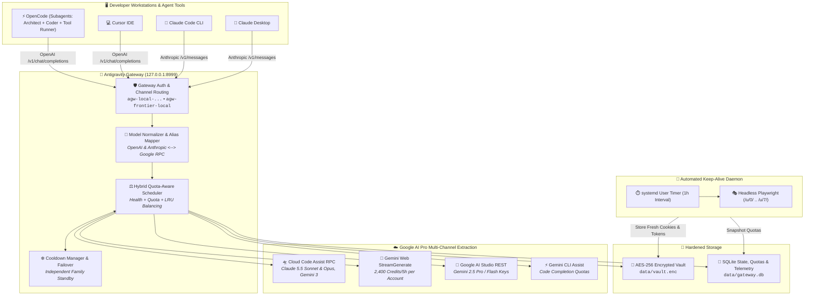

# 🚀 Secured Google AI Extractor & Multi-Account API Gateway

[](https://python.org)
[](https://fastapi.tiangolo.com)
[](https://platform.openai.com/docs/api-reference)
[](https://docs.anthropic.com/en/api/getting-started)
[](#-zero-leakage-vault-security)
[](LICENSE)

A high-performance, self-hosted local inference gateway that extracts and aggregates **Google AI Pro / Gemini Advanced subscriptions** across multiple accounts into unified, standard **OpenAI (`/v1/chat/completions`)** and **Anthropic (`/v1/messages`)** endpoints.

Extract every drop of intelligence and quota from your Google AI Pro accounts—unlocking **Claude 3.7 / 5.5 Sonnet, Claude Opus 5.5, 1M Mega-Context, Gemini 3.8 Flash, and Gemini 2.5 / 3 Pro** with zero per-token API charges, automated multi-account load balancing, intelligent 429 failover, and automated perpetual session keep-alive.

---

## 📑 Table of Contents

1. [Key Features](#-key-features)
2. [System Architecture](#-system-architecture)
3. [Curated Model Catalog](#-curated-model-catalog)
4. [Automated Multi-Account Session Keeper (Never Expires)](#-automated-multi-account-session-keeper-never-expires)
5. [Unified 4-Channel Quota & Limits Monitor](#-unified-4-channel-quota--limits-monitor)
6. [OpenCode & Autonomous Subagent Integration](#-opencode--autonomous-subagent-integration)
7. [Installation & Quick Start](#-installation--quick-start)
8. [Account Connections Setup Guide](#-account-connections-setup-guide)
   - [Channel 1: Google OAuth Sign-In (Cloud Code Engine)](#channel-1-google-oauth-sign-in-cloud-code-engine)
   - [Channel 2: Automated Gemini Web Session Extraction (`gweb`)](#channel-2-automated-gemini-web-session-extraction-gweb)
   - [Channel 3: Google AI Studio API Key (`studio`)](#channel-3-google-ai-studio-api-key-studio)
   - [Channel 4: Gemini Cloud CLI (`gcli`)](#channel-4-gemini-cloud-cli-gcli)
9. [Client Integration Guides](#-client-integration-guides)
   - [Cursor IDE](#1-cursor-ide-setup)
   - [Claude Code CLI](#2-claude-code-cli-setup)
   - [OpenCode & Roo Code](#3-opencode--roo-code-setup)
   - [Claude Desktop GUI](#4-claude-desktop-gui-setup)
10. [Developer & Debugging Guide](#-developer--debugging-guide)
11. [License](#-license)

---

## 🌟 Key Features

* **4-Way Extraction Engine**: Extract quotas simultaneously across all 4 pathways per Google account:
  1. 🛸 **Google Cloud Code OAuth** (`agy`): Native Google Cloud Code token unlocking Claude 3.7 / 5.5 Sonnet, Claude Opus 5.5, and Gemini 3 Pro.
  2. 🍪 **Gemini Advanced Web Session** (`gweb`): Consumer `gemini.google.com` sessions extracted via Playwright & `curl_cffi` (Chrome TLS impersonation) with 2,400 credits/5h per account at zero cost.
  3. 🔑 **Google AI Studio Key** (`studio`): Independent developer RPM quotas (15 RPM / 1,500 RPD) with zero billing requirements.
  4. ⚡ **Gemini Cloud CLI** (`gcli`): Automated developer CLI code assist channel.
* **Perpetual Auto-Keeper Daemon**: Headless Playwright automation navigates Google multi-account indices (`/u/0/` through `/u/7/`) to extract fresh `SNlM0e` tokens and rotated `__Secure-1PSIDTS` cookies automatically via systemd timer. **Sessions never expire—zero manual cookie copying.**
* **Unified 4-Channel Quota & Limits Monitor**: Complete real-time dashboard modal (`#channel-limits-modal`) tracking rate limits, sliding windows, request quotas, and token throughput in one place.
* **Hybrid Intelligent Load Balancer**: Combines health scoring, token capacity, remaining quota percentage, and LRU (Least Recently Used) idle weighting to distribute requests smoothly across multiple accounts.
* **Seamless Rate-Limit (429) Failover**: Isolated cooldown managers prevent account lockouts and rotate upstream accounts instantly without dropping user requests.
* **Zero-Leakage AES-256 Vault**: All OAuth tokens, refresh keys, and browser session cookies are encrypted on disk using AES-256-GCM (`chmod 600`).
* **Dual OpenAI & Anthropic Protocol Support**: Fully compatible with tools expecting OpenAI (`/v1/chat/completions`) or Anthropic (`/v1/messages`).
* **OpenCode Agentic Tool Calling & Subagents**: Native integration with OpenCode and Antigravity SDK MCP, allowing automatic delegation between primary architect (`claude-opus-5.5`), fast coder (`gemini-3.8-flash-high`), and tool runner (`gemini-pro-agent`).

---

## 🏗️ System Architecture



---

## 🤖 Curated Model Catalog

The gateway exposes all models over OpenAI-compatible IDs (`/v1/models`):

### 1. Claude Flagship & Reasoning (Antigravity OAuth Engine)
| Model ID | Context Window | Primary Capability & Role |
| :--- | :---: | :--- |
| **`claude-opus-5.5`** | 200,000 tokens | Deep theoretical reasoning, system architecture, hard logic (OpenCode Default). |
| **`claude-sonnet-5.5`** | 200,000 tokens | Flagship frontier coding, refactoring, and complex agentic workflows. |
| **`claude-opus-5[1m]`** | **1,000,000 tokens** | Maximum-reasoning ultra-long context analysis across large repos. |
| **`claude-sonnet-5[1m]`** (`1m-mega`) | **1,000,000 tokens** | Ultra-massive context window for auditing full multi-repo codebases. |
| **`claude-fable-5`** | 200,000 tokens | Exploratory prototyping and code synthesis. |

### 2. Gemini High-Speed Coding & Agentic Models
| Model ID | Context Window | Primary Capability & Role |
| :--- | :---: | :--- |
| **`gemini-3.8-flash-high`** (`speed-flash`) | 1,000,000 tokens | Sub-second latency execution for rapid code edits and unit tests (OpenCode `coder`). |
| **`gemini-pro-agent`** (`agentic-pro`) | 1,000,000 tokens | Autonomous multi-step tool callings and shell executions (OpenCode `tool-runner`). |
| **`gemini-3.1-pro-low`** (`gemini-pro`) | 1,000,000 tokens | High-efficiency system planning and architecture reasoning. |
| **`gemini-2.5-flash`** / `gemini-2.5-flash-lite` | 1,000,000 tokens | Lightweight rapid coding assistant. |

### 3. Consumer Gemini Web Sessions (`gweb` Channel)
| Model ID | Context Window | Underlying Engine & Quota |
| :--- | :---: | :--- |
| **`gemini-advanced`** (`gemini-2.5-pro`) | 1,000,000 tokens | Gemini Advanced Pro reasoning (**2,400 credits / 5h per account**). |
| **`gemini-flash-web`** (`gemini-2.5-flash`) | 1,000,000 tokens | Fast consumer web tier (**2,400 credits / 5h per account**). |
| **`gemini-2.0-flash-thinking-exp`** | 1,000,000 tokens | Step-by-step transparent thinking scratchpad. |

---

## 🔄 Automated Multi-Account Session Keeper (Never Expires)

Google multi-account logins use indexed paths (`/u/0/` through `/u/7/`) and rotate `__Secure-1PSIDTS` every 1–2 hours. The gateway includes an automated keeper that completely eliminates manual cookie entry:

### How It Works
1. **Automated Harvesting:** `scripts/gweb_auto_keeper.py` launches a lightweight headless Chrome instance via Playwright.
2. **Multi-User Navigation:** Visits `/u/0/` through `/u/7/`, evaluates Google's authorization handshake, and extracts active `SNlM0e` tokens and fresh cookies in under 30 seconds.
3. **Encrypted Storage:** Updates `data/vault.enc` with `{account_id}:cookies` and sets `cookies_verified = 1` in `data/gateway.db`.
4. **Live Quota Telemetry:** Fetches real-time 5-hour and weekly credit limits (e.g. 2,375 / 2,400 remaining) and stores snapshots in SQLite.
5. **Systemd Automation:** Configured as a background timer (`antigravity-gweb-keeper.timer`) that runs every 1 hour.

```bash
# Run one-shot sync manually
python3 scripts/gweb_auto_keeper.py --once

# Trigger via Gateway HTTP API
curl -X POST http://127.0.0.1:8999/admin/channels/geminiweb/sync-all

# Check systemd timer status
systemctl --user list-timers | grep gweb-keeper
```

---

## 📊 Unified 4-Channel Quota & Limits Monitor

Open the Administrative Dashboard at **`http://127.0.0.1:8999/admin/dashboard`** to view the **Unified 4-Channel Usage Limits & Quotas modal**:

* **🛸 Google OAuth (`agy`):** Real-time 5-hour sliding window percentage per account.
* **🍪 Gemini Web (`gweb`):** Real-time remaining credits (e.g. 2,375/2,400 per 5h window) and reset timestamps.
* **🔑 Google AI Studio (`studio`):** RPD / RPM usage tracking against the 1,500 requests/day limit.
* **⚡ Gemini CLI (`gcli`):** Developer code completion volume and latency tracking.
* **⚡ 1-Click Sync Buttons:** Includes `⚡ Auto-Sync GWeb` on Card 3 and `⚡ Auto-Harvest & Refresh All 7 Accounts` in the modal.

---

## 🤖 OpenCode & Autonomous Subagent Integration

The gateway is paired with **OpenCode Web** and the **Antigravity SDK MCP** to implement a multi-agent hierarchy:

```
                  ┌───────────────────────────────┐
                  │      Primary Architect        │
                  │       claude-opus-5.5         │
                  └──────────────┬────────────────┘
                                 │
                 ┌───────────────┴───────────────┐
                 ▼                               ▼
  ┌──────────────────────────────┐ ┌──────────────────────────────┐
  │        Coder Subagent        │ │     Tool Runner Subagent     │
  │    gemini-3.8-flash-high     │ │       gemini-pro-agent       │
  │   (Sub-second code writing)  │ │   (Terminal & agentic tools) │
  └──────────────────────────────┘ └──────────────────────────────┘
```

Your `~/.config/opencode/opencode.json` configuration:
```json
{
  "$schema": "https://opencode.ai/config.json",
  "provider": {
    "antigravity": {
      "npm": "@ai-sdk/openai-compatible",
      "name": "Antigravity Gateway",
      "options": {
        "baseURL": "http://127.0.0.1:8999/v1",
        "apiKey": "agw-frontier-local"
      }
    }
  },
  "mcp": {
    "antigravity-sdk": {
      "type": "local",
      "command": [
        "/home/rarebat/secure-agent-lab/bridge/venv/bin/python",
        "/home/rarebat/.config/opencode/antigravity_mcp.py"
      ],
      "enabled": true
    }
  },
  "agent": {
    "coder": {
      "model": "antigravity/gemini-3.8-flash-high",
      "mode": "subagent"
    },
    "tool-runner": {
      "model": "antigravity/gemini-pro-agent",
      "mode": "subagent"
    }
  },
  "model": "antigravity/claude-opus-5.5"
}
```

---

## 📦 Installation & Quick Start

### 1. Prerequisites
- **Python**: Version `3.11` or higher
- **Google Chrome**: Installed on the local machine
- **Linux systemd** (for automated keep-alive services)

### 2. Setup Virtual Environment & Dependencies

```bash
cd antigravity-gateway-src/antigravity-gateway-main

# Create and activate virtual environment
python3 -m venv venv
source venv/bin/activate

# Install required dependencies
pip install -r requirements.txt
pip install playwright curl_cffi gemini-webapi browser-cookie3
```

### 3. Launch the Gateway Daemon

```bash
# Run gateway server on http://127.0.0.1:8999
PYTHONPATH=src python3 -m agw.main
```

Or enable the background systemd service:
```bash
systemctl --user enable --now antigravity-gateway.service
systemctl --user enable --now antigravity-gweb-keeper.timer
```

---

## 👥 Account Connections Setup Guide

Open **[http://127.0.0.1:8999/admin/dashboard](http://127.0.0.1:8999/admin/dashboard)** in your browser:

### Channel 1: Google OAuth Sign-In (Cloud Code Engine)
1. Click **`+ Add Google Account`** or **`⚡ Setup Channels`**.
2. Click **`⚡ Sign In with Google`** to authorize Code Assist permissions.
3. The gateway exchanges PKCE tokens and securely encrypts the refresh token in AES-256 storage.

### Channel 2: Automated Gemini Web Session Extraction (`gweb`)
* Click **`⚡ Auto-Sync GWeb`** on Card 3. The headless keeper will automatically harvest and bind all logged-in Google accounts (`/u/0/` through `/u/7/`) without manual entry.

### Channel 3: Google AI Studio API Key (`studio`)
* In the **AI Studio Key** tab, paste your `AIza...` key from [Google AI Studio](https://aistudio.google.com/app/apikey) and click **Save**.

### Channel 4: Gemini Cloud CLI (`gcli`)
* Bind your Google Cloud CLI credentials to enable CLI code assist tokens.

---

## 🔌 Client Integration Guides

### 1. Cursor IDE Setup
* **OpenAI Base URL**: `http://127.0.0.1:8999/v1`
* **API Key**: `agw-frontier-local` (or your dashboard key)
* **Models**: `claude-sonnet-5.5`, `claude-opus-5.5`, `gemini-3.8-flash-high`, `gemini-advanced`

### 2. Claude Code CLI Setup
```bash
export ANTHROPIC_BASE_URL="http://127.0.0.1:8999"
export ANTHROPIC_API_KEY="agw-frontier-local"

claude
```

### 3. OpenCode & Roo Code Setup
Set baseURL to `http://127.0.0.1:8999/v1` with model `claude-opus-5.5` or `speed-flash`.

---

## 🛠️ Developer & Debugging Guide

### Running Verification Tests
```bash
pytest tests/ -q
```
*Current test suite: **78 passed in ~5s**.*

### Testing Live Chat Completions via Curl
```bash
curl -s -X POST http://127.0.0.1:8999/v1/chat/completions \
  -H "Content-Type: application/json" \
  -d '{
    "model": "gemini-3.8-flash-high",
    "messages": [{"role": "user", "content": "What is 10 + 20?"}]
  }' | jq .
```

### Checking 4-Channel Quota Telemetry
```bash
curl -s http://127.0.0.1:8999/admin/channels/summary | jq .
```

---

## 🔒 Zero-Leakage Vault Security

* **Disk Encryption**: Credentials are never written in plain text. Tokens are encrypted using AES-256-GCM.
* **Persistent Identity**: Secrets reside in `data/identity.json` and `data/vault.enc` (`chmod 600`).
* **Git Hygiene**: Sensitive databases and keys (`data/*.db`, `data/*.enc`, `data/*.key`, `.env`) are strictly ignored in `.gitignore`.

---

## 📄 License

This project is licensed under the [MIT License](LICENSE).
