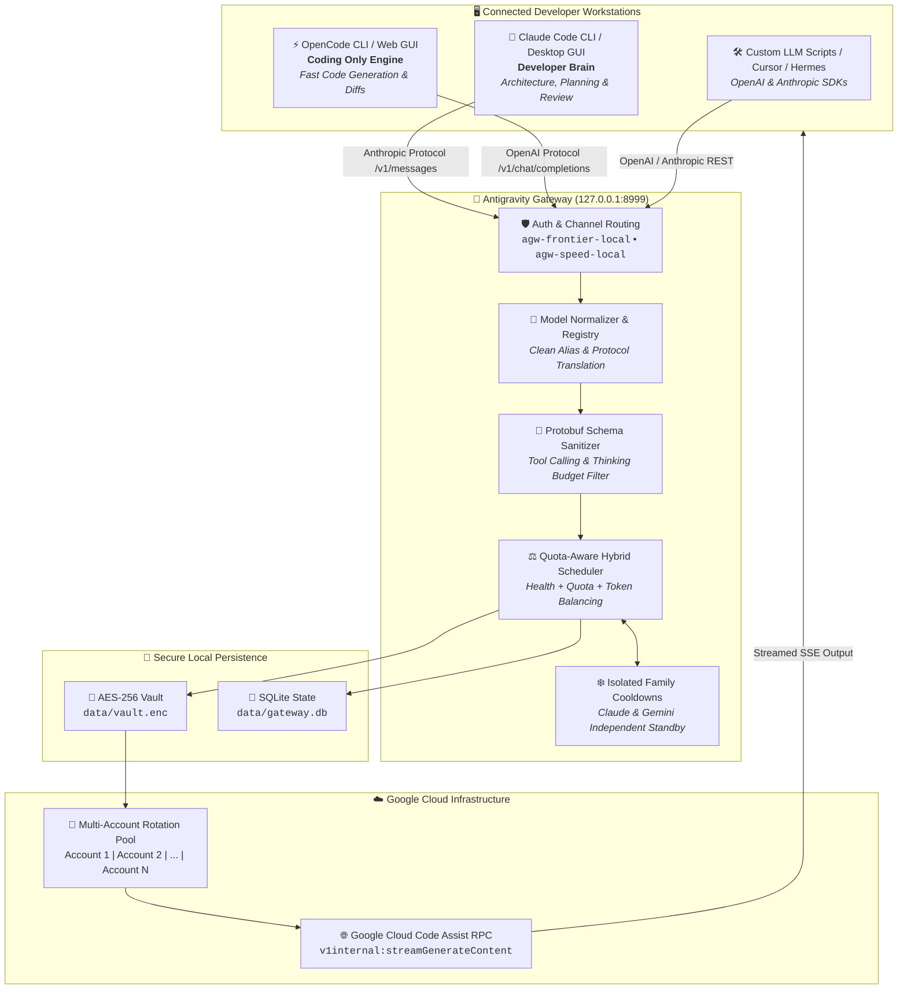

# Antigravity Gateway (AGW)

[](LICENSE)
[](https://python.org)
[](https://fastapi.tiangolo.com)
[](https://platform.openai.com/docs/api-reference)
[](https://docs.anthropic.com/en/api/getting-started)
[](#zero-leakage-credential-security)

A high-performance, self-hosted local inference gateway and account load balancer that aggregates multiple **authorized Google accounts** into unified OpenAI-compatible (`/v1/chat/completions`) and Anthropic-compatible (`/v1/messages`) endpoints.

It powers a seamless **dual-agent workflow**: running **Claude Code** (as the high-reasoning **Developer Brain**) and **OpenCode** (as the high-speed **Coding Engine**) simultaneously on your PC with zero rate-limit collisions, intelligent quota failover, and hardware-grade credential security.

---

## 📑 Table of Contents

- [System Architecture](#-system-architecture)
- [Prerequisites](#-prerequisites)
- [Installation Guide](#-installation-guide)
  - [Step 1: Clone and Set Up Virtual Environment](#step-1-clone-and-set-up-virtual-environment)
  - [Step 2: Initialize Configuration](#step-2-initialize-configuration)
  - [Step 3: Connect Google Accounts](#step-3-connect-google-accounts)
  - [Step 4: Launch the Gateway Daemon](#step-4-launch-the-gateway-daemon)
- [Client Integration Guides](#-client-integration-guides)
  - [1. Claude Code CLI Setup](#1-claude-code-cli-setup)
  - [2. OpenCode CLI Setup](#2-opencode-cli-setup)
  - [3. Claude Desktop GUI Setup](#3-claude-desktop-gui-setup)
- [Operational Suggestions & Best Practices](#-operational-suggestions--best-practices)
  - [Model Selection & Quota Economics](#1-model-selection--quota-economics)
  - [Multi-Account Pooling Strategy](#2-multi-account-pooling-strategy)
  - [Vault Security & Git Hygiene](#3-vault-security--git-hygiene)
- [Verification & Health Check Guide](#-verification--health-check-guide)
  - [Check 1: Gateway Daemon & Health Probe](#check-1-gateway-daemon--health-probe)
  - [Check 2: Model Listing Verification](#check-2-model-listing-verification)
  - [Check 3: OpenAI API Completion Test](#check-3-openai-api-completion-test)
  - [Check 4: Anthropic Messages API Test](#check-4-anthropic-messages-api-test)
  - [Check 5: Claude Code CLI Live Test](#check-5-claude-code-cli-live-test)
  - [Check 6: OpenCode CLI Live Test](#check-6-opencode-cli-live-test)
  - [Check 7: Web Dashboard Inspection](#check-7-web-dashboard-inspection)
- [Troubleshooting & FAQ](#-troubleshooting--faq)
- [License](#-license)

---

## 🏗️ System Architecture



---

## 📋 Prerequisites

Ensure your system meets the following requirements before installation:

| Requirement | Minimum Version | Purpose |
|---|---|---|
| **Operating System** | Linux (Ubuntu/Debian/Arch/Fedora), macOS 13+, or Windows WSL2 | Host platform |
| **Python** | `3.11` or higher | Gateway runtime and dependencies |
| **Node.js** | `v18.0.0` or higher | Required for Claude Code CLI (`@anthropic-ai/claude-code`) |
| **Git** | `2.30+` | Source repository management |
| **Google Account** | 1 or more accounts | Access to Google Cloud Code developer quota |

---

## 🚀 Installation Guide

### Step 1: Clone and Set Up Virtual Environment

1. Clone the repository and enter the project directory:
   ```bash
   git clone https://github.com/RareBat47/antigravity-gateway.git
   cd antigravity-gateway
   ```

2. Create an isolated Python virtual environment:
   ```bash
   python3 -m venv .venv
   source .venv/bin/activate
   ```

3. Upgrade `pip` and install project dependencies:
   ```bash
   pip install --upgrade pip
   pip install -r requirements.txt
   pip install -e .
   ```

---

### Step 2: Initialize Configuration

1. Create your local `config.yaml` from the example template:
   ```bash
   cp config.example.yaml config.yaml
   ```

2. Generate a secure Master Gateway API key:
   ```bash
   python3 -c "import secrets; print('agw-local-' + secrets.token_urlsafe(32))"
   ```

3. Open `config.yaml` and verify the server settings:
   ```yaml
   server:
     host: "127.0.0.1"
     port: 8999
     debug: false

   security:
     gateway_api_key: "agw-local-YOUR_GENERATED_KEY"
     admin_api_key: "agw-admin-YOUR_GENERATED_ADMIN_KEY"
     rate_limit_per_minute: 120
   ```

---

### Step 3: Connect Google Accounts

The gateway supports multiple ways to link Google accounts into its local encrypted vault:

#### Method A: Auto-Detect Local CLI Session (Fastest)
If you already use Google Antigravity CLI (`agy`) or Cloud Code locally:
```bash
python3 -m agw.cli.main accounts detect-local
```
This imports your active session token directly from `~/.gemini/antigravity-cli`.

#### Method B: Browser PKCE OAuth Sign-In
1. Start the gateway (Step 4 below).
2. Open the Admin Dashboard: [http://127.0.0.1:8999/admin/dashboard](http://127.0.0.1:8999/admin/dashboard).
3. Click **"Add Account"** $\to$ **"Sign In with Google"**.
4. Complete Google authentication in your browser. The authorization code exchanges automatically and saves into your local AES-256 vault.

#### Method C: Manual Token Import via CLI
```bash
python3 -m agw.cli.main accounts add \
  --label "Personal-Google-1" \
  --email "user@gmail.com" \
  --token "1//0g..."
```

---

### Step 4: Launch the Gateway Daemon

Launch the gateway server using Python:

```bash
# Foreground execution (for logs & debugging)
PYTHONPATH=src python3 -m agw.main

# Or run in background via nohup
PYTHONPATH=src nohup python3 -m agw.main > data/gateway.log 2>&1 &
```

Once running:
- **Admin Dashboard**: [http://127.0.0.1:8999/admin/dashboard](http://127.0.0.1:8999/admin/dashboard)
- **Health Check Endpoint**: [http://127.0.0.1:8999/health](http://127.0.0.1:8999/health)
- **OpenAI Endpoint**: `http://127.0.0.1:8999/v1`
- **Anthropic Endpoint**: `http://127.0.0.1:8999/v1`

---

## 👥 Client Integration Guides

### 1. Claude Code CLI Setup

Claude Code acts as your primary **Developer Brain** for architectural decisions, complex reasoning, and multi-file code reviews.

1. Install Claude Code globally via npm:
   ```bash
   npm install -g @anthropic-ai/claude-code
   ```

2. Configure environment variables in your shell configuration (`~/.bashrc` or `~/.zshrc`):
   ```bash
   # Point Claude Code to the local gateway
   export ANTHROPIC_BASE_URL="http://127.0.0.1:8999"
   export ANTHROPIC_API_KEY="agw-frontier-local"

   # Create launcher aliases
   alias claude-frontier="ANTHROPIC_MODEL=frontier-5.1 claude"
   alias claude-mega="ANTHROPIC_MODEL=1m-mega claude"
   ```

3. Reload your shell:
   ```bash
   source ~/.bashrc
   ```

4. Launch Claude Code:
   ```bash
   claude-frontier
   ```

---

### 2. OpenCode CLI Setup

OpenCode is designed for **Pure Coding Only** (sub-second diff generation, rapid test authoring, and file refactoring).

1. Install OpenCode:
   ```bash
   # If installing via npm
   npm install -g opencode-ai
   # Or using standalone Linux binary
   curl -fsSL https://opencode.ai/install.sh | bash
   ```

2. Configure `~/.config/opencode/opencode.json`:
   ```json
   {
     "$schema": "https://opencode.ai/config.json",
     "provider": "custom-openai",
     "custom": {
       "baseURL": "http://127.0.0.1:8999/v1",
       "apiKey": "agw-speed-local",
       "defaultModel": "speed-flash",
       "temperature": 0.2
     }
   }
   ```

3. Start OpenCode:
   ```bash
   # Interactive TUI mode
   opencode

   # Direct command execution
   opencode run "Write unit tests for src/agw/auth/crypto.py"
   ```

---

### 3. Claude Desktop GUI Setup

For visual workflows and desktop interaction:

1. Open your Claude Desktop configuration file:
   - **Linux**: `~/.config/Claude/claude_desktop_config.json`
   - **macOS**: `~/Library/Application Support/Claude/claude_desktop_config.json`
   - **Windows**: `%APPDATA%\Claude\claude_desktop_config.json`

2. Add or update the endpoint configuration:
   ```json
   {
     "mcpServers": {
       "filesystem": {
         "command": "npx",
         "args": ["-y", "@modelcontextprotocol/server-filesystem", "/home/rarebat"]
       }
     },
     "apiBaseUrl": "http://127.0.0.1:8999",
     "apiKey": "agw-frontier-local",
     "defaultModel": "frontier-5.1"
   }
   ```

---

## 💡 Operational Suggestions & Best Practices

### 1. Model Selection & Quota Economics

To maximize your free quota and avoid rate-limit delays, follow these operational rules:

| Workstation Task | Recommended Model | Bound Channel | Reason |
|---|---|---|---|
| **High-Frequency Code Edits & Diffs** | `speed-flash` (Gemini Flash) | `agw-speed-local` | Sub-second latency, near-infinite token throughput. |
| **System Architecture & Deep Reasoning** | `frontier-5.1` (Sonnet 5.5) | `agw-frontier-local` | Top-tier reasoning capability with thinking tokens. |
| **Whole-Codebase Repository Audits** | `1m-mega` (1M Context) | `agw-megacontext-local` | Ingests entire projects; reserve strictly for audits to conserve quota. |
| **Complex Diagnostic Escalation** | `agentic-pro` (Gemini Pro Agent) | `agw-agentic-local` | Deep multi-turn reasoning when a quick fix fails. |

> [!TIP]
> **Use the 90/10 Rule**: Perform 90% of your daily edits and test writing in **OpenCode** using `speed-flash`. Escalate the remaining 10% of architectural problems to **Claude Code** using `frontier-5.1`.

---

### 2. Multi-Account Pooling Strategy

- **Connect at least 3 to 7 Google accounts**: Having multiple accounts in the pool provides continuous 24/7 uptime. When one account reaches its rate-limit window (HTTP 429), the gateway automatically shifts traffic to the next healthy account.
- **Independent Cooldown Isolation**: The gateway tracks Claude and Gemini rate limits independently. If account 1 enters cooldown on Claude models, its Gemini quota remains active and operational.

---

### 3. Vault Security & Git Hygiene

- **Keep Vault Keys Private**: Your credentials are encrypted in `data/vault.enc` using `data/vault.key`.
- **Never Commit Secrets**: Ensure `.gitignore` includes:
  ```gitignore
  data/*.db
  data/*.enc
  data/*.key
  data/*.json
  config.yaml
  ```

---

## 🔍 Verification & Health Check Guide

Run this verification checklist after setup to guarantee that every component is properly connected and functioning.

### Check 1: Gateway Daemon & Health Probe
Verify that the gateway process is running and detecting your accounts:
```bash
curl -s http://127.0.0.1:8999/health | jq .
```
**Expected Response:**
```json
{
  "status": "ok",
  "active_accounts": 7,
  "total_accounts": 7,
  "total_requests": 24
}
```

---

### Check 2: Model Listing Verification
Query the model catalog using the Frontier channel key:
```bash
curl -s http://127.0.0.1:8999/v1/models \
  -H "Authorization: Bearer agw-frontier-local" | jq '.data[0:5]'
```
**Expected Response:**
A JSON array listing active model objects such as `frontier-5.1`, `claude-sonnet-5.5`, `claude-opus-5.5`, and `speed-flash`.

---

### Check 3: OpenAI API Completion Test
Test the OpenAI-compatible endpoint with the high-speed coding model:
```bash
curl -s http://127.0.0.1:8999/v1/chat/completions \
  -H "Authorization: Bearer agw-speed-local" \
  -H "Content-Type: application/json" \
  -d '{
    "model": "speed-flash",
    "messages": [
      {"role": "user", "content": "Respond with exactly: SPEED_FLASH_ONLINE"}
    ],
    "max_tokens": 20
  }' | jq '.choices[0].message.content'
```
**Expected Response:**
`"SPEED_FLASH_ONLINE"`

---

### Check 4: Anthropic Messages API Test
Test the Anthropic-compatible endpoint with the Frontier reasoning model:
```bash
curl -s http://127.0.0.1:8999/v1/messages \
  -H "x-api-key: agw-frontier-local" \
  -H "anthropic-version: 2023-06-01" \
  -H "Content-Type: application/json" \
  -d '{
    "model": "frontier-5.1",
    "max_tokens": 30,
    "messages": [
      {"role": "user", "content": "Respond with: FRONTIER_REASONING_READY"}
    ]
  }' | jq '.content[0].text'
```
**Expected Response:**
`"FRONTIER_REASONING_READY"`

---

### Check 5: Claude Code CLI Live Test
Test Claude Code directly from your terminal:
```bash
claude -p "Respond in one word: ONLINE"
```
**Expected Behavior:** Claude Code connects immediately without prompt authentication errors and outputs confirmation.

---

### Check 6: OpenCode CLI Live Test
Test OpenCode execution:
```bash
opencode run "echo 'Gateway integration verified'"
```
**Expected Behavior:** OpenCode resolves through `http://127.0.0.1:8999/v1` and completes execution cleanly.

---

### Check 7: Web Dashboard Inspection
Open [http://127.0.0.1:8999/admin/dashboard](http://127.0.0.1:8999/admin/dashboard) in your browser:
1. Verify that your accounts appear in the **Authorized Accounts Pool** with active status badges.
2. Click **"Probe All Accounts"** to trigger round-trip latency checks.
3. Check the **Connected Applications Tracker Table** to confirm that Claude Code CLI, Claude Desktop GUI, and OpenCode show active green connection badges.

---

## 🛠️ Troubleshooting & FAQ

### Q1: `Error: Address already in use (port 8999)`
**Cause**: An existing instance of the gateway is already running.  
**Fix**: Find and terminate the previous process:
```bash
lsof -i :8999
kill -9 $(lsof -t -i :8999)
PYTHONPATH=src python3 -m agw.main
```

### Q2: Claude Code returns `401 Unauthorized`
**Cause**: The API key or base URL in your environment is incorrect.  
**Fix**: Ensure your environment variables match `config.yaml`:
```bash
export ANTHROPIC_BASE_URL="http://127.0.0.1:8999"
export ANTHROPIC_API_KEY="agw-frontier-local"
```

### Q3: `429 Resource Exhausted / Rate Limit` on a model
**Cause**: The active Google account has temporarily hit its quota window.  
**Fix**: The gateway handles this automatically by routing subsequent requests to another account in your pool. To increase throughput, connect 2 or more additional Google accounts in the dashboard.

### Q4: How do I backup or transfer my accounts?
**Fix**: Copy the encrypted vault files to your backup destination:
```bash
cp data/vault.enc data/vault.key backup/
```
To restore on a new machine, place both files into the `data/` directory before starting the gateway.

---

## 📜 License

Distributed under the MIT License. See [LICENSE](LICENSE) for more information.
