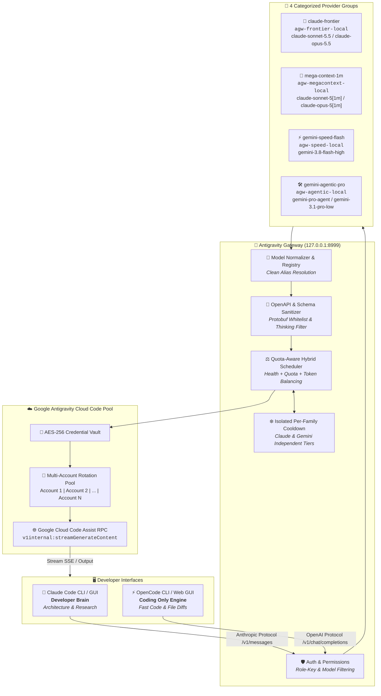

# Antigravity Gateway

[](LICENSE)
[](https://python.org)
[](https://fastapi.tiangolo.com)
[](https://platform.openai.com/docs/api-reference)
[](https://docs.anthropic.com/en/api/getting-started)
[](#the-curated-7-model-catalog)
[](#provider-2--claude-5-1m-mega-context)

A high-performance, self-hosted local inference gateway and load balancer that aggregates multiple **authorized Google Antigravity accounts** into OpenAI-compatible (`/v1/chat/completions`) and Anthropic-compatible (`/v1/messages`) APIs. 

It powers a seamless **dual-agent workflow**: running **Claude Code** (as the high-reasoning **Developer Brain**) and **OpenCode** (as the high-speed **Coding Engine**) simultaneously on your PC with zero rate-limit collisions, intelligent quota failover, and hardware-grade credential security.

---

> [!IMPORTANT]
> ### 💡 Installation Philosophy: *Use Antigravity for Installing This Software*
> **The recommended and fastest way to install, configure, and maintain this gateway is to let Google Antigravity pair-program with you.**  
> Simply clone this repository, open your terminal with Antigravity (`agy`), and instruct the agent to run the setup commands. Antigravity handles the Python venvs, Node.js dependencies, OAuth token extraction, and model provider routing automatically.

---

## 🚀 Quick Setup & Getting Started

Follow these steps to get the gateway, Claude Code, and OpenCode running simultaneously on your PC.

### Step 1: Install & Launch Gateway
```bash
# 1. Clone repository
git clone https://github.com/RareBat47/antigravity-gateway.git
cd antigravity-gateway

# 2. Set up virtual environment and install dependencies
python3 -m venv .venv
source .venv/bin/activate
pip install -r requirements.txt
pip install -e .

# 3. Start the gateway daemon
python -m agw.main
```
* **Dashboard Hub**: [http://127.0.0.1:8999/admin/dashboard](http://127.0.0.1:8999/admin/dashboard)
* **Health Check**: [http://127.0.0.1:8999/health](http://127.0.0.1:8999/health)
* **Model Catalog**: `GET http://127.0.0.1:8999/v1/models`

### Step 2: Connect Google Accounts
Open the [Admin Web Dashboard](http://127.0.0.1:8999/admin/dashboard) and connect your Google Antigravity accounts (or run `python -m agw.cli.main accounts login`). The gateway automatically encrypts tokens with AES-256 in your local vault.

---

## 👥 Dual-Agent Operating Guide: Simultaneous Execution

Run **Claude Code** and **OpenCode** side-by-side without interference:

```
┌─────────────────────────────────────────────────────────────────────────────┐
│                           DEVELOPER WORKSPACE                               │
├──────────────────────────────────────┬──────────────────────────────────────┤
│  🧠 CLAUDE CODE (Developer Brain)     │  ⚡ OPENCODE (Coding Only Engine)    │
│  • System architecture & planning    │  • Pure code execution & file edits  │
│  • Deep research & whole-repo audits │  • Sub-second interactive latency    │
│  • Models: Frontier 5.5 & 1M Mega    │  • Models: Gemini 3.8 Flash High     │
│  • MCP: Filesystem & Memory tools    │  • Skill: Agentic Pro Escalation     │
└──────────────────────────────────────┴──────────────────────────────────────┘
```

### 1. Claude Code CLI & GUI — The Developer Brain
Claude Code acts as your primary architect, lead developer, and researcher.

```bash
# Launch with Frontier 5.5 Flagship (claude-sonnet-5.5 / claude-opus-5.5)
claude-frontier

# Or launch with 1M Mega-Context for whole-repository audits (claude-sonnet-5[1m])
claude-mega

# Or standard CLI command (pre-configured to gateway in ~/.bashrc)
claude
```
* **Global Directive**: Pre-configured in `~/.claude/CLAUDE.md` to act as the master Developer Brain.
* **Integrated MCP Servers**: Automatic access to `@modelcontextprotocol/server-filesystem` and `@modelcontextprotocol/server-memory`.
* **Desktop GUI**: Configured in `~/.config/Claude/claude_desktop_config.json`.

### 2. OpenCode CLI & Web GUI — Pure Coding Engine
OpenCode is strictly constrained to **CODING ONLY** (no conversational filler, pure implementation, bug fixing, and test generation).

```bash
# Start OpenCode interactive terminal TUI (defaults to gemini-3.8-flash-high)
opencode

# Start OpenCode Web GUI in your browser
opencode web

# Execute a direct coding task via CLI
opencode run "Implement JWT validation middleware"
```
* **Locked Default Engine**: `gemini-3.8-flash-high` for sub-second responses and instant file modifications.
* **On-Demand Escalation**: Includes the `agentic-pro-escalation` skill. When facing complex architectural dilemmas or deep bugs, it dynamically escalates to `agentic-pro/gemini-pro-agent` or `agentic-pro/gemini-3.1-pro-low`, then immediately returns to speed flash.

---

## 📊 Product Working Methods & Architecture Flowchart



---

## 🔑 4-Way Connections (agy • gweb • studio • gcli) & Provider APIs

The gateway aggregates whatever can be accessed for free from Google into **4 primary connection channels**, plus dedicated dual-agent developer profiles:

| Channel / Provider | Virtual API Key | Base URL | Primary Upstream Source | Curated Models Available Free |
|---|---|---|---|---|
| **`agy` (Antigravity OAuth)** | `agw-agy-local` | `http://127.0.0.1:8999/v1` | Google Antigravity Cloud Code Assist | `claude-sonnet-5.5`, `claude-opus-5.5`, `claude-sonnet-5[1m]`, `claude-opus-5[1m]`, `claude-fable-5`, `claude-sonnet-5`, `claude-opus-5`, `gemini-3.8-flash-high`, `gemini-3.7-flash-high`, `gemini-pro-agent`, `gemini-3.1-pro-low`, `gpt-oss-120b-medium` |
| **`gweb` (Gemini Web Sessions)** | `agw-gweb-local` | `http://127.0.0.1:8999/v1` | Consumer Gemini Web Session (`__Secure-1PSID` / `SNlM0e`) | `gemini-2.5-pro` (Web Advanced), `gemini-2.5-flash`, `gemini-2.0-flash-thinking-exp`, `gemini-advanced` |
| **`studio` (Google AI Studio)** | `agw-studio-local` | `http://127.0.0.1:8999/v1` | Google AI Studio Free Developer API Keys (`AIza...`) | `gemini-2.5-pro`, `gemini-2.5-flash`, `gemini-2.5-flash-lite`, `gemini-2.0-flash`, `gemini-2.0-flash-thinking-exp`, `gemini-1.5-pro`, `gemini-1.5-flash`, `gemini-1.5-flash-8b` |
| **`gcli` (Gemini CLI Protocol)** | `agw-gcli-local` | `http://127.0.0.1:8999/v1` | Google Cloud CLI / Cloud Code gcli OAuth | `gemini-code-assist`, `gemini-1.5-pro` |
| **`claude-frontier`** | `agw-frontier-local` | `http://127.0.0.1:8999/v1` | Claude Code Developer Brain Profile | `frontier-5.1` / `claude-sonnet-5.5`, `claude-opus-5.5` + Unlocked Free Google Catalog |
| **`mega-context-1m`** | `agw-megacontext-local` | `http://127.0.0.1:8999/v1` | Mass Repository Audit Profile | `1m-mega` / `claude-sonnet-5[1m]`, `claude-opus-5[1m]` + Unlocked Free Google Catalog |
| **`gemini-speed-flash`** | `agw-speed-local` | `http://127.0.0.1:8999/v1` | OpenCode Pure Coding Profile | `speed-flash` / `gemini-3.8-flash-high`, `gemini-2.5-flash` + Unlocked Free Google Catalog |
| **`gemini-agentic-pro`** | `agw-agentic-local` | `http://127.0.0.1:8999/v1` | OpenCode Escalation Profile | `agentic-pro` / `gemini-pro-agent`, `gemini-3.1-pro-low`, `gemini-2.5-pro` + Unlocked Free Google Catalog |
| **`Master Gateway`** | `agw-local-dE9X...` | `http://127.0.0.1:8999/v1` | Universal Master Key | *All Free Models Across All 4 Channels* |

---

## 🎯 Golden Rules for Proper API Consumption

To ensure optimal performance and avoid burning through account limits:

* ⚡ **Keep OpenCode strictly on `gemini-speed-flash` (`speed-flash`)**:
  * Gemini 3.8 Flash High & Gemini 2.5 Flash provide near-instantaneous streaming and handle 95% of all code authoring, typing, and refactoring with zero rate-limit anxiety.
* 🧠 **Reserve `1m-mega` for Whole-Repo Audits Only**:
  * 1,000,000 tokens consume quota significantly faster. Use `claude-mega` or `1m-mega` when you need to ingest an entire multi-folder codebase or analyze massive log traces. For day-to-day coding, stick to `frontier-5.1`.
* 🛠️ **Use `gemini-agentic-pro` via the Escalation Protocol**:
  * When OpenCode encounters a tricky bug that fails after two attempts, escalate to `agentic-pro` to formulate a solution blueprint, then immediately revert to `speed-flash` to write the code.
* 🔒 **4-Way Cross-Channel Redundancy**:
  * Because the gateway manages Antigravity OAuth (`agy`), Gemini Web (`gweb`), AI Studio (`studio`), and Gemini CLI (`gcli`), if any single channel encounters an upstream cooldown, **requests transparently fail over to the next healthy free connection with zero disruption.**

---

## 🧩 Comprehensive Free Google AI Model Reference

| Model Identifier | Primary 4-Way Channel | Context Window | Max Output | Features & Strengths |
|---|---|---|---|---|
| `frontier-5.1` / `claude-sonnet-5.5` | `agy` (Antigravity) | 200,000 | 16,384 | Flagship coding & reasoning, thinking tokens |
| `claude-opus-5.5` | `agy` (Antigravity) | 200,000 | 16,384 | Deep architectural synthesis, thinking tokens |
| `1m-mega` / `claude-sonnet-5[1m]` | `agy` (Antigravity) | 1,000,000 | 16,384 | 1M mega-context, whole-codebase audits |
| `claude-opus-5[1m]` | `agy` (Antigravity) | 1,000,000 | 16,384 | 1M mega-context, deep long-context reasoning |
| `claude-fable-5` | `agy` (Antigravity) | 200,000 | 16,384 | Experimental fast frontier coding |
| `speed-flash` / `gemini-3.8-flash-high` | `agy` (Antigravity) | 1,048,576 | 65,536 | Sub-second latency, high-throughput streaming, tool calling |
| `gemini-3.7-flash-high` | `agy` (Antigravity) | 1,048,576 | 65,536 | Hybrid thinking & fast streaming |
| `agentic-pro` / `gemini-pro-agent` | `agy` (Antigravity) | 1,048,576 | 65,536 | Autonomous multi-turn agent execution, tools |
| `gemini-3.1-pro-low` | `agy` (Antigravity) | 1,048,576 | 65,536 | Pro reasoning, structural planning, tool calling |
| `gemini-2.5-pro` | `studio` / `gweb` | 2,097,152 | 65,536 | 2M context flagship reasoning free tier |
| `gemini-2.5-flash` | `studio` / `gweb` | 1,048,576 | 65,536 | High-throughput ultra-fast free tier |
| `gemini-2.5-flash-lite` | `studio` | 1,048,576 | 65,536 | Sub-100ms ultra-low latency free tier |
| `gemini-2.0-flash` | `studio` | 1,048,576 | 65,536 | Multimodal free tier inference |
| `gemini-2.0-flash-thinking-exp` | `studio` / `gweb` | 1,048,576 | 65,536 | Experimental deep reasoning free tier |
| `gemini-1.5-pro` | `studio` | 2,097,152 | 65,536 | 2M context developer free tier |
| `gemini-1.5-flash` | `studio` | 1,048,576 | 65,536 | Lightweight developer free tier |
| `gemini-code-assist` | `gcli` (Gemini CLI) | 1,048,576 | 65,536 | Google Cloud CLI developer completions |
| `gpt-oss-120b-medium` | `agy` (Antigravity) | 131,072 | 32,768 | Open-weights 120B parameter model via Google infra |

---

## 🛡️ Core Engineering Highlights

### 1. Smart Quota-Aware Hybrid Scheduling
Requests are routed using a multi-factor scoring formula:
$$\text{Score} = w_{\text{health}} \cdot H - w_{\text{tokens}} \cdot \hat{T} + w_{\text{quota}} \cdot Q - w_{\text{lru}} \cdot \Delta t$$
Accounts with low remaining quota or recent failures are automatically deferred, giving healthy accounts priority while keeping depleted accounts on standby.

### 2. Isolated Per-Family Cooldowns
Upstream 429 rate limits on `claude` models only place the account in cooldown for the `claude` family. Its `gemini` quota remains active and accessible. Cooldowns step through progressive backoff tiers (`60s` $\to$ `300s` $\to$ `1800s` $\to$ `7200s`) and persist across restarts in SQLite.

### 3. Strict Protobuf Schema Sanitizer
Translates standard OpenAI and Claude tool declarations into Google's strict Cloud Code Protobuf schema. Strips unsupported draft schema fields (`propertyNames`, `additionalProperties`, etc.) and formats `thinkingConfig` budgets cleanly to avoid upstream 400 Bad Request errors.

### 4. Zero-Leakage Credential Security
Refresh tokens are stored with AES-256 encryption. Bearer tokens, secrets, and auth headers are automatically stripped and redacted across all log sinks.

---

## 🖥️ Admin Web Dashboard

Access the real-time dashboard at:
👉 **[http://127.0.0.1:8999/admin/dashboard](http://127.0.0.1:8999/admin/dashboard)**

* **Live Account Pool**: View Gmail IDs, free/pro account status, health scores, and individual connection statuses.
* **One-Click Health Check**: Manually ping and refresh all connections on demand.
* **Provider Categories Hub**: Copy keys and endpoints for `claude-frontier`, `mega-context-1m`, `gemini-agentic-pro`, and `gemini-speed-flash`.
* **Aggregated Usage & Cooldown Tracker**: Real-time stats on combined quota limits and accounts on cooldown with auto-clear timers.

---

## 📜 License

MIT License — see [LICENSE](LICENSE) for details.
